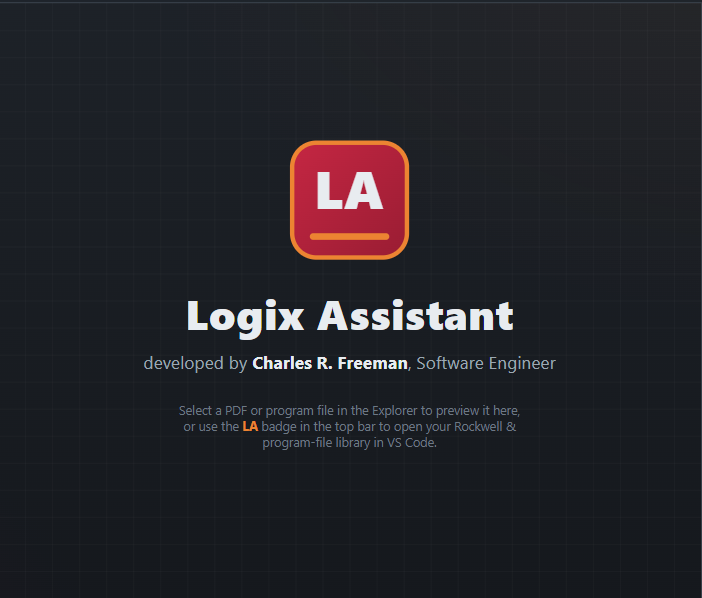

# Delta V Read Notes

I'll look for the Delta V read tags in your PLC program files.

Search for `delta ?v.?read`

Ran terminal command: Get-ChildItem 'C:\Users\Chero\OneDrive\Desktop\plc programs' -Recurse -File -Include *.L5K,*.L5X,*.CSV,*.txt,*.pdf | Select-Object -First 60 FullName,Length | Format-Table -AutoSize | Out-String -Width 250

Search for `delta|dv_|deltav|\bDV`

Ran terminal command: Get-ChildItem 'C:\Users\Chero\OneDrive\Desktop\plc programs' -Recurse -File | Where-Object { $_.Extension -in '.csv','.l5k','.l5x','.txt','.xml','.png','.pdf' -and $_.FullName -notmatch 'glasswasher_pdf' } | Select-Object FullName,Length,LastWriteTime | Format-Table -AutoSize | Out-String -Width 250

Read 
Completed with input: {
  "path": "C:\\Users\\Chero\\OneDrive\\Desktop\\plc programs\\20005.png"
}

Ran terminal command: Get-ChildItem 'C:\Users\Chero\OneDrive\Desktop\plc programs' -Recurse -File | Sort-Object LastWriteTime -Descending | Select-Object -First 15 FullName,Length,LastWriteTime | Format-Table -AutoSize | Out-String -Width 250

Ran terminal command: python -c "import pypdf;print(pypdf.__version__)"; python -c "import fitz;print(fitz.__doc__)"; where.exe pdftotext
Tool execution failed with exit code 1

Ran terminal command: $s=@'
import pymupdf,glob,os,re
out=r"C:\Users\Chero\AppData\Local\Temp\pdftxt"
os.makedirs(out,exist_ok=True)
for f in glob.glob(r"C:\Users\Chero\OneDrive\Desktop\plc programs\**\*.pdf",recursive=True):
    try:
        d=pymupdf.open(f); t="\n".join(f"\n=====PAGE {i+1}=====\n"+p.get_text() for i,p in enumerate(d))
    except Exception as e:
        print("ERR",f,e); continue
    n=len(re.findall(r"delta\s*-?v|dv[_\s]?read",t,re.I))
    open(os.path.join(out,os.path.relpath(f,r"C:\Users\Chero\OneDrive\Desktop\plc programs").replace("\\","__")+".txt"),"w",encoding="utf8").write(t)
    if n: print(n,len(t),f)
'@
$s | python -

Search for `delta\s*-?v.*read|read.*delta|dv_?read`

Search for `delta\s*-?v`

Read , lines 820 to 1150
Completed with input: {
  "path": "C:\\Users\\Chero\\AppData\\Local\\Temp\\pdftxt\\meco__Logix Designer Report(s).pdf.txt",
  "view_range": [
    820,
    1150
  ]
}

Search for `^(Routine|Rung|MainProgram - |.*Ladder Diagram|.*\(Routine\))`

Read , lines 9660 to 9830
Completed with input: {
  "path": "C:\\Users\\Chero\\AppData\\Local\\Temp\\pdftxt\\meco__Logix Designer Report(s).pdf.txt",
  "view_range": [
    9660,
    9830
  ]
}

Read , lines 10060 to 10460
Completed with input: {
  "path": "C:\\Users\\Chero\\AppData\\Local\\Temp\\pdftxt\\meco__Logix Designer Report(s).pdf.txt",
  "view_range": [
    10060,
    10460
  ]
}

Search for `UNIT_STATUS|fill`

session_store_sql
Completed with input: {
  "description": "Find prior Delta V read[5] discussion",
  "query": "SELECT session_id, turn_index, substr(user_message,1,300) AS u, timestamp FROM turns WHERE timestamp > now() - INTERVAL '14 days' AND (user_message ILIKE '%read[5]%' OR user_message ILIKE '%delta v%' OR user_message ILIKE '%deltav%') ORDER BY timestamp DESC LIMIT 20"
}

session_store_sql
Completed with input: {
  "description": "Local prior Delta V discussion",
  "source": "local",
  "query": "SELECT session_id, turn_index, substr(user_message,1,300) AS u FROM turns WHERE user_message LIKE '%read[5]%' OR user_message LIKE '%delta v%' OR user_message LIKE '%DeltaV%' LIMIT 20"
}

Ran terminal command: Get-ChildItem 'C:\Users\Chero\OneDrive\Desktop\plc programs' -Recurse -File -Include *.acd | Where-Object {$_.Name -notmatch 'BAK'} | Select-Object FullName,Length,LastWriteTime | Format-Table -AutoSize | Out-String -Width 250

Read , lines 15730 to 15960
Completed with input: {
  "path": "C:\\Users\\Chero\\AppData\\Local\\Temp\\pdftxt\\meco__Logix Designer Report(s).pdf.txt",
  "view_range": [
    15730,
    15960
  ]
}

Search for `MSS_START_PERM|PERMISSIVE|Permissive`

Read , lines 14564 to 15120
Completed with input: {
  "path": "C:\\Users\\Chero\\AppData\\Local\\Temp\\pdftxt\\meco__Logix Designer Report(s).pdf.txt",
  "view_range": [
    14564,
    15120
  ]
}

Search for `MSS_SHUTDOWN|MSS_ALERT|HEARTBEAT_AUX|ALERT_ALARM_SU_DELAY\b`

Read , lines 9340 to 9470
Completed with input: {
  "path": "C:\\Users\\Chero\\AppData\\Local\\Temp\\pdftxt\\meco__Logix Designer Report(s).pdf.txt",
  "view_range": [
    9340,
    9470
  ]
}

Read , lines 9600 to 9660
Completed with input: {
  "path": "C:\\Users\\Chero\\AppData\\Local\\Temp\\pdftxt\\meco__Logix Designer Report(s).pdf.txt",
  "view_range": [
    9600,
    9660
  ]
}

Read , lines 12185 to 12930
Completed with input: {
  "path": "C:\\Users\\Chero\\AppData\\Local\\Temp\\pdftxt\\meco__Logix Designer Report(s).pdf.txt",
  "view_range": [
    12185,
    12930
  ]
}

Read , lines 12650 to 12925
Completed with input: {
  "path": "C:\\Users\\Chero\\AppData\\Local\\Temp\\pdftxt\\meco__Logix Designer Report(s).pdf.txt",
  "view_range": [
    12650,
    12925
  ]
}

Search for `^(LCV_100_INTERLOCK|HOT_STANDBY|MCB|TIMER_OUT|LOSS_COM_DISPLAY|D_V_REMOTE_STA...`

Read , lines 9622 to 9690
Completed with input: {
  "path": "C:\\Users\\Chero\\AppData\\Local\\Temp\\pdftxt\\meco__Logix Designer Report(s).pdf.txt",
  "view_range": [
    9622,
    9690
  ]
}

Search for `^LCV_100_INTERLOCK$`

Search for `LCV_100_INTERLOCK|LT_100_FAIL|LT_100.*(FAULT|FAIL)`

Read , lines 14380 to 14452
Completed with input: {
  "path": "C:\\Users\\Chero\\AppData\\Local\\Temp\\pdftxt\\meco__Logix Designer Report(s).pdf.txt",
  "view_range": [
    14380,
    14452
  ]
}

Read , lines 8557 to 8800
Completed with input: {
  "path": "C:\\Users\\Chero\\AppData\\Local\\Temp\\pdftxt\\meco__Logix Designer Report(s).pdf.txt",
  "view_range": [
    8557,
    8800
  ]
}

Read , lines 9297 to 9342
Completed with input: {
  "path": "C:\\Users\\Chero\\AppData\\Local\\Temp\\pdftxt\\meco__Logix Designer Report(s).pdf.txt",
  "view_range": [
    9297,
    9342
  ]
}

I'm assuming you mean the MECO9497 program, since that's the only report I found that documents `DELTA_V_READ`. It's the Logix Designer report dated 10/15, so the values are a snapshot. The program has no "fill" logic as such, so I treated "filling" as the feed valve LCV_100 opening or the unit starting. Tell me if you meant a different program.

`DELTA_V_READ[5]` is `UNIT_STATUS`: 0 = Out of Service, 1 = Hot Standby, 2 = Running, 3 = Oil Recirc, 4 = Permissive Active.

**What a 4 means:** the unit is in hot standby but `MSS_START_PERM` is false. That needs two things, and neither raises an alarm:
- `LUBE_OIL_SHUTDWN_TIMER.DN` must be done. It's a 45 s timer that runs after the unit stops.
- `EVAP_PRESSURE_PERM` must be true. That's a 180 s timer that needs `PT_103_EU >= 0.8` while in hot standby. If the pressure dips, the timer restarts.

**Other silent blockers among the reads:**

| Read | What it does | Why it's quiet |
|---|---|---|
| `[0].1`, `[0].2`, `[0].6` (Auto / Manual / Off switch) | DeltaV remote start only works with the switch in Auto. In Off there's no hot standby, no start, and the feed valve is forced closed. | Just a switch position. |
| `[0].5` (comm-lost timer) | A 5 s timer feeds a 10 s timer, which sets `HEARTBEAT_AUX`. That bit blocks the unit start (`MCB`). | Possibly quiet. I didn't check what the OIT does with `HEARTBEAT_AUX`. |
| `[0].3` (critical alarm = `MSS_SHUTDOWN`) | Blocks the unit start. Each alarm bit is latched, so after the condition clears it still needs ACK, then RESET. | An alarm that was acknowledged but not reset can look quiet. |
| `[3].0` to `[3].11` (shutdown group) | `[3].3` (high distillate conductivity, `AAH_200`) is not in the group. A bit reading 0 means an alarm or a latched alarm. Every shutdown bit must read 1 before you can start. | Same as above. |
| `[3].5` (`LAH_100_AUX`, high feed level) | A 0 forces the LCV_100 feed valve closed. | Shows on the HMI as a normal alarm. |

Not blockers: `[0].4` (alert alarm) doesn't stop the start, and `[2].x` and `[3].12`/`[3].13` don't either. `[2].12`–`[2].15` and `[3].14`/`[3].15` are spares.

The feed valve is also forced closed if `LT_100_AI` reads at or below -500 (`LCV_100_INTERLOCK`). That isn't a DeltaV read. In hot standby the valve is capped at 40%.

In the snapshot, `[0]`=2 (Auto), `[2]`=1346 (`HOT_STANDBY` set) and `[3]`=16383 (no alarms) all look good. The only thing holding was the permissive timer at 73.8 of 180 s, with `PT_103_EU` at 1.53.

If yours has sat at 4 longer than 3 minutes, check that `PT_103` stays at or above 0.8. Then check `[3]` for any bit that reads 0, and press Acknowledge then Reset.